# cell-ledger


🏆 **First place, [Gauntlet AI Champions vs. Challengers](https://luma.com/jx1xu350).** This
project was built in 24 hours as part of the Gauntlet AI 24-hour hackathon.

**A specialist agent for public RNA-seq data.** Ask a biological research question, and cell-ledger
finds real human bulk RNA-seq studies on NIH GEO, checks that they fit, labels every sample,
runs one clean differential-expression comparison per study, and pools the answer across
studies. Every number on screen comes from a file you can open.


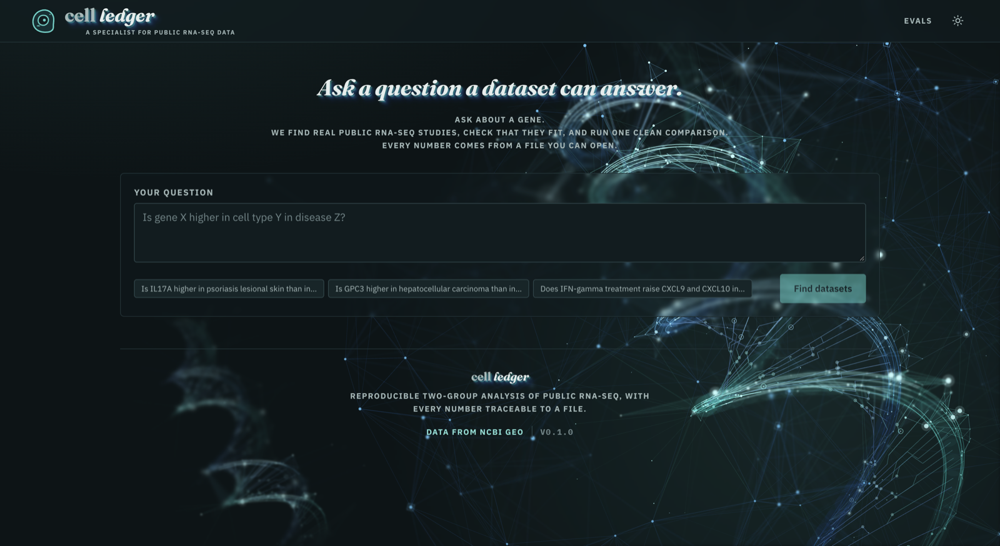

> *"Is IL17A higher in psoriasis lesional skin than in non-lesional skin?"*
>
> About two minutes later: **yes, in both datasets.** GSE67785 (log2FC +7.4, padj 5e-13,
> paired by donor) and GSE186063 (log2FC +7.6, padj 2e-8), with a cross-dataset comparison
> on top.

## What you get

Each finished study opens to an interactive volcano plot. Click any gene to open a panel built
from public references: where it's expressed in the body (GTEx), where it sits in the cell
(Human Protein Atlas / UniProt), its 3D structure (AlphaFold) and its interaction partners
(STRING).

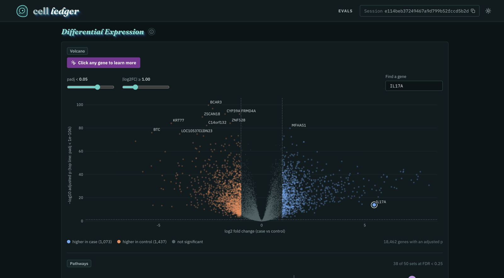

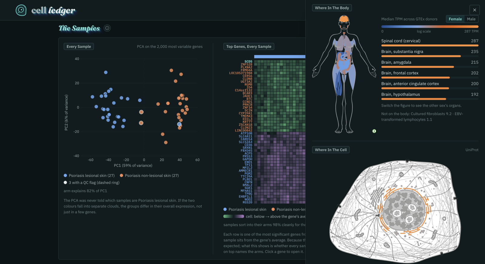

Pathway enrichment (GSEA, MSigDB Hallmark) shows as a network of the top gene sets and the
leading genes they share, and as a ranked dot plot.

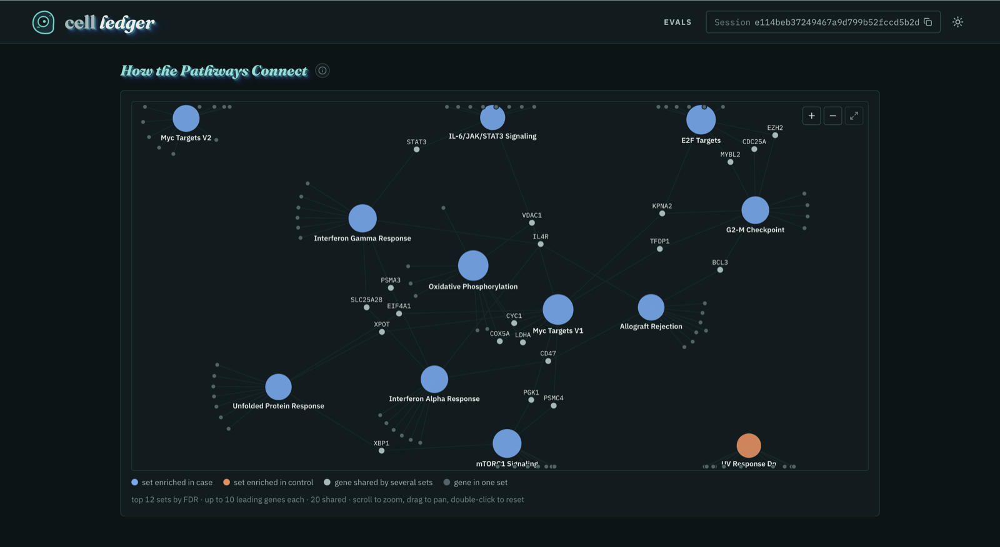

| | |
|---|---|
| 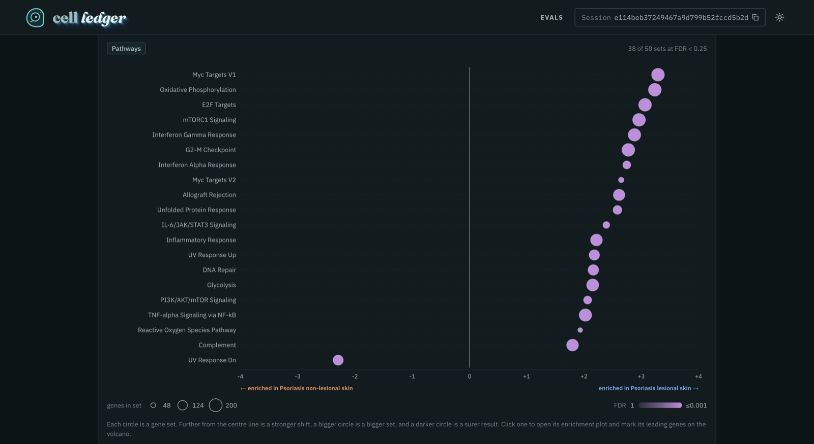 | 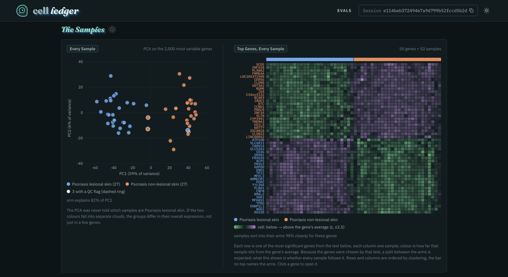 |
| 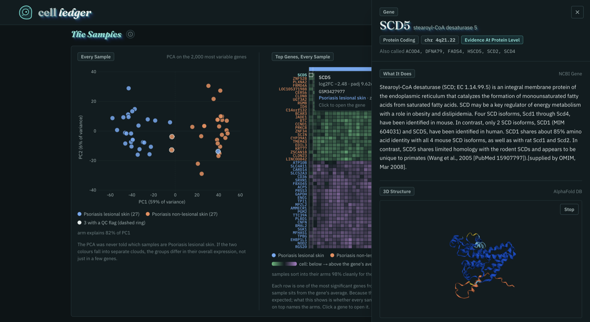 | 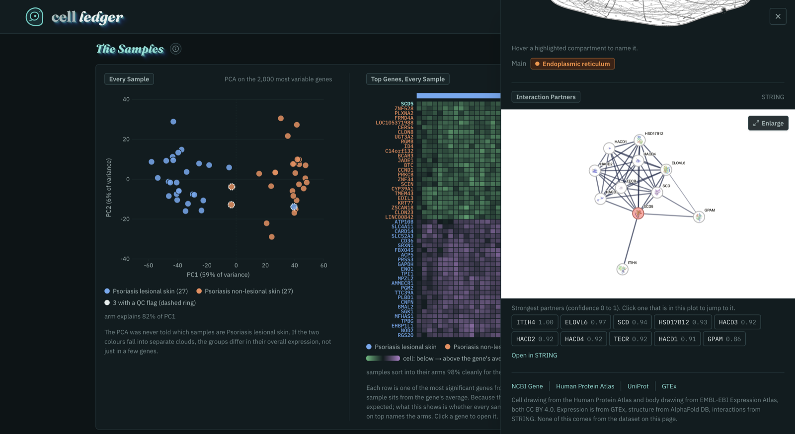 |

The QC view runs PCA without telling it the sample labels, so you can see whether the two arms
separate on their own. The heatmap shows whether every sample follows the top genes, not just
the average.

## How it works

You do two things: **ask**, then **tick the datasets to download.** Everything after that runs
on its own.

**1. Discover.** Claude (Opus) searches GEO with several phrasings and inspects candidate series
sample by sample. It streams its reasoning and every tool call as it goes. If the question is
ambiguous, it asks a clarifying question instead of guessing.

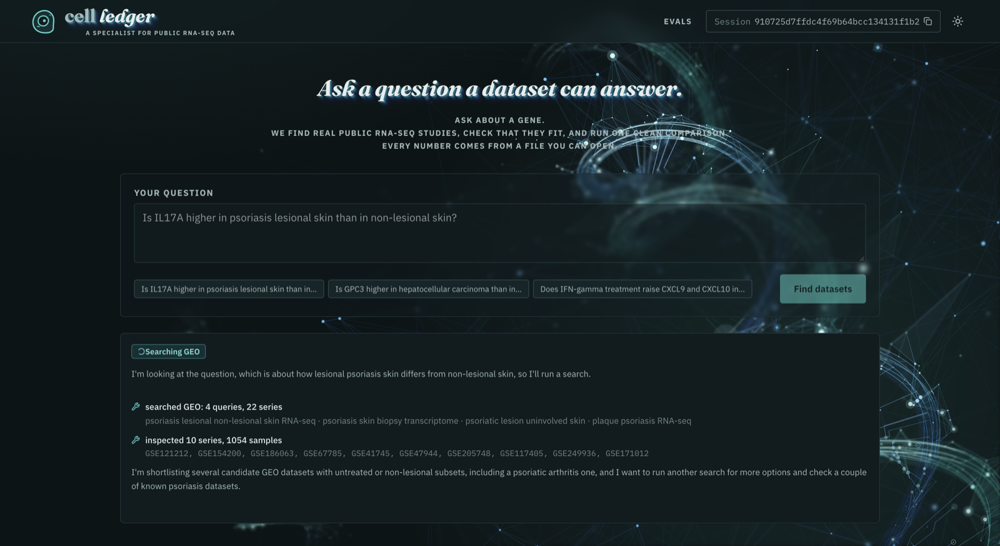

**2. Choose.** Each candidate comes with its proposed case and control arms, sample counts and
caveats. Every accession shown was confirmed by GEO in this search.

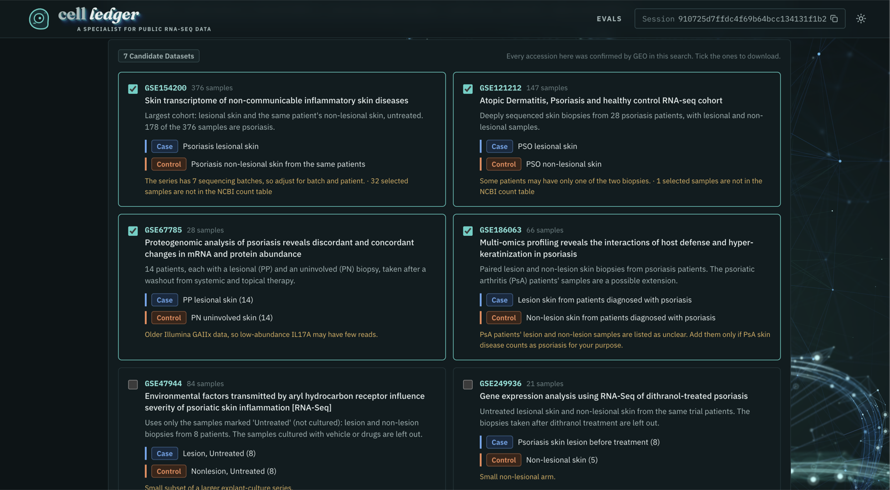

**3. Design, run, compare.** For each downloaded dataset, Claude (Sonnet) labels every sample,
quoting the GEO record verbatim, and picks the one contrast that answers the question. The
pipeline then runs: QC, low-count filtering, DESeq2, GSEA and gene lookup. When two or more
studies finish, a random-effects meta-analysis pools them.

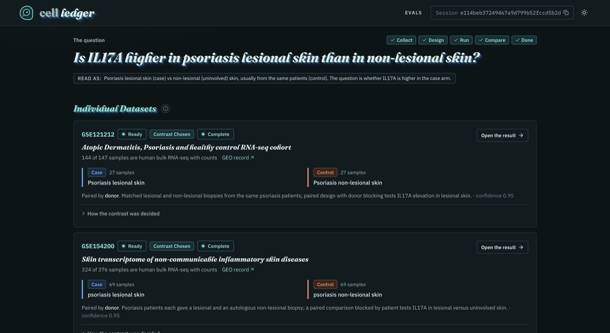

**4. Read the answer.** Each run states the verdict for the genes you asked about, how the
contrast was decided, and any caveats. Every result can be downloaded: counts, DE table, GSEA
table, figures and the canonical `report.json`.

| | |
|---|---|
| 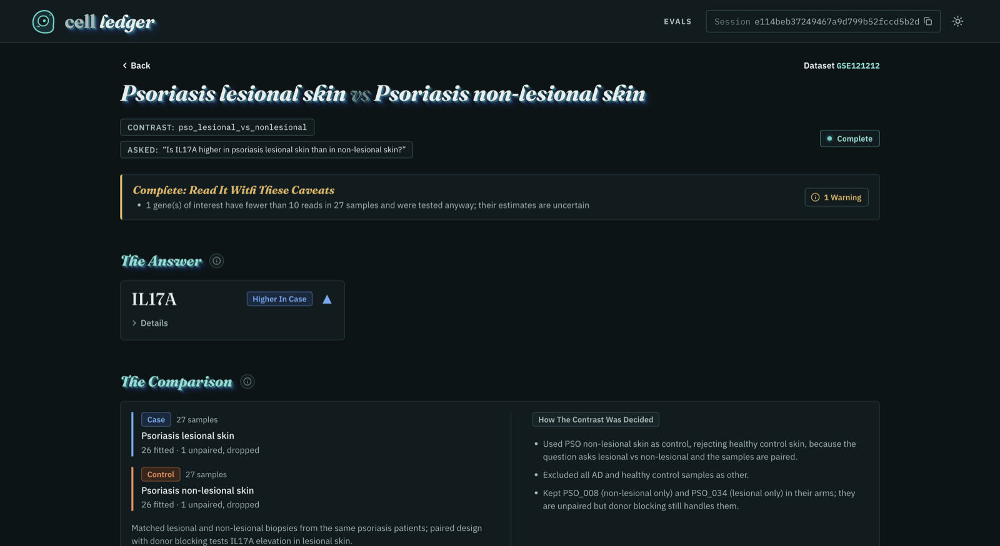 | 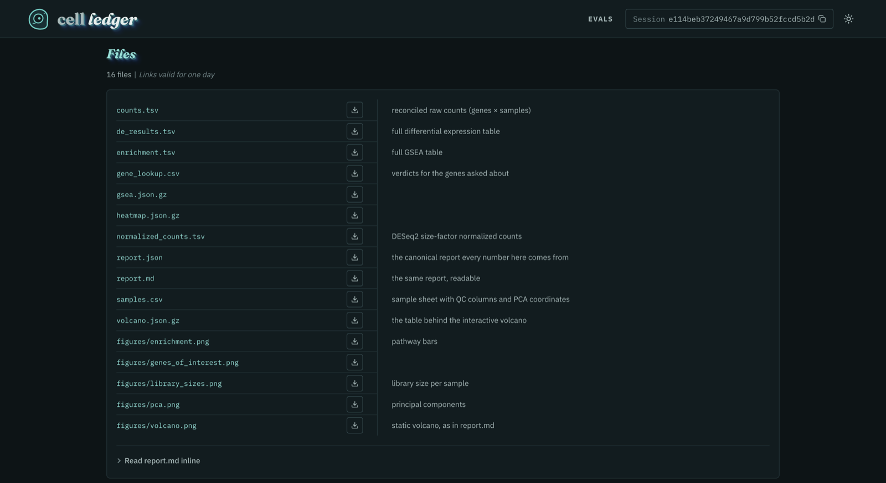 |

## Why you can trust it

- **No invented datasets.** Discovery can only return accessions that GEO confirmed during that
  run, and every result carries a trace of each query and what it returned.
- **Every label has evidence.** The sample-sheet validator rejects any case or control label
  that doesn't quote the GEO record.
- **Pairing is enforced in code.** When the same donors give samples to both arms, the design is
  blocked by donor even if the model forgets to say so.
- **Your genes are always tested.** A gene you asked about is kept even when its counts fall
  below the low-count filter. The result says so and flags its estimate as uncertain.
- **Reproducible.** Every run records its parameters, versions and a fingerprint over the inputs.

## Evals

We gave cell-ledger and the same Claude model with web search and web fetch the same 12
dataset-discovery questions. Each question has an answer key: the GEO series that can answer
it and, within each series, which samples belong in each arm.

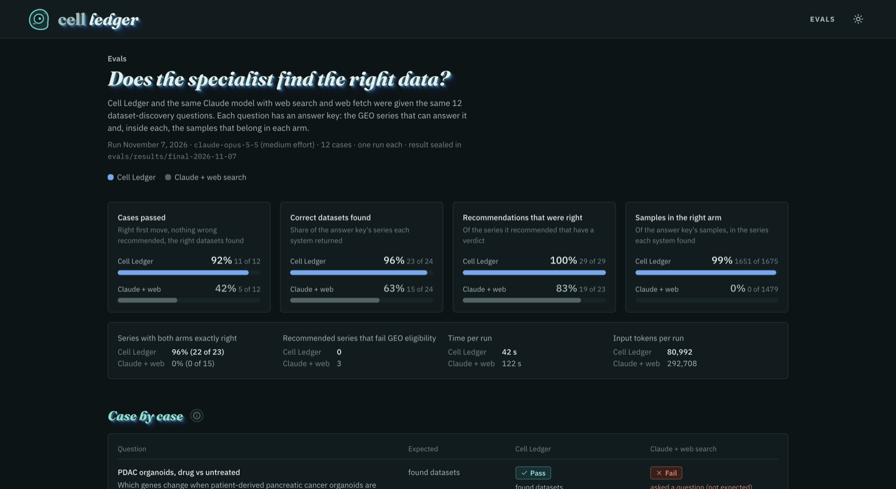

| Metric | cell-ledger | Claude + web search |
|---|---|---|
| Cases passed | **92%** (11/12) | 42% (5/12) |
| Correct datasets found (recall) | **96%** (23/24) | 63% (15/24) |
| Recommendations that were right (precision) | **100%** (29/29) | 83% (19/23) |
| Samples placed in the right arm | **99%** (1651/1675) | 0% (0/1479) |
| Recommended series that fail GEO eligibility | **0** | 3 |
| Time per run | **42 s** | 122 s |
| Input tokens per run | **81k** | 293k |

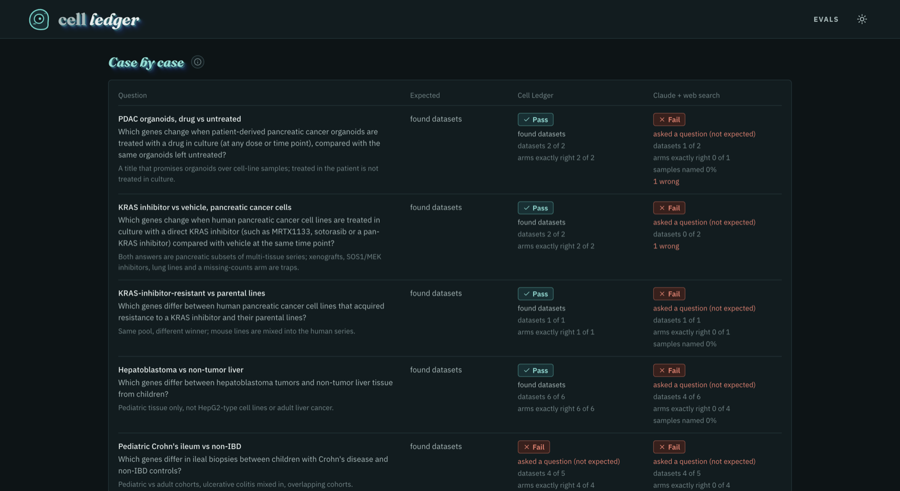

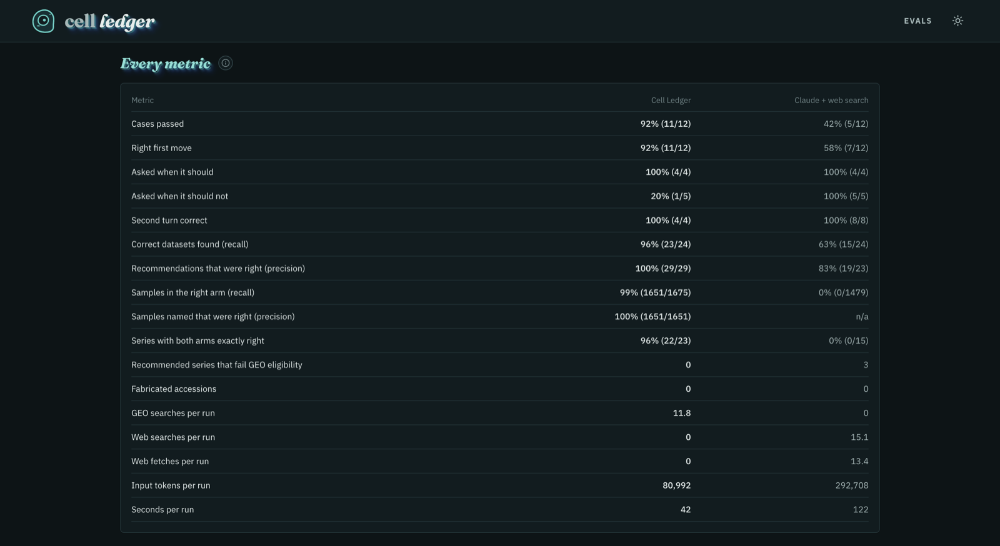

Run on 2026-11-07 with `claude-opus-5-5` (medium effort), one run per case. The sealed results
are in `evals/results/final-2026-11-07`, and the method is described in [evals/README.md](evals/README.md).

The same page also checks the analysis step: the pipeline rerun on three GEO series whose
authors published differential expression tables, with the pipeline's log2 fold change plotted
against the authors' for every comparison (R² 0.71 to 0.96). The write-up and the scripts to
reproduce it are in [docs/validation](docs/validation/README.md).

## Architecture

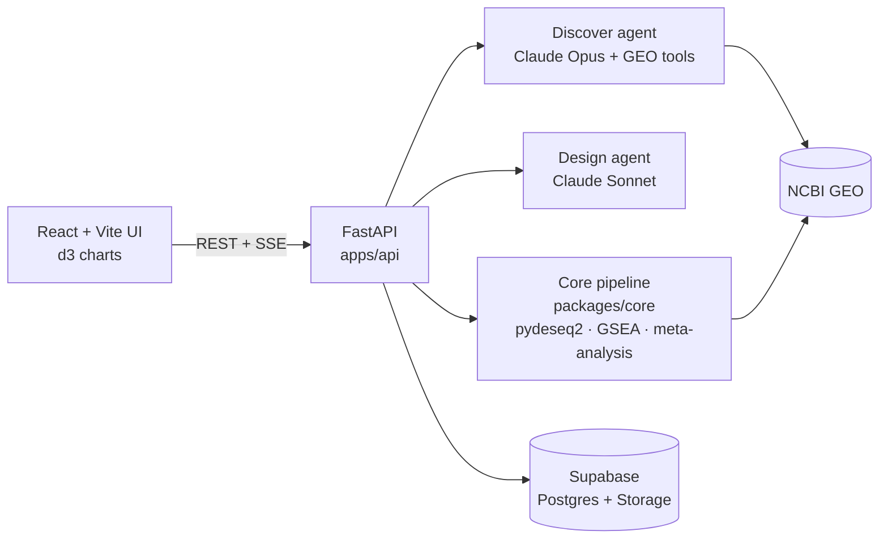

- **`packages/core`** is a pure-Python pipeline library with no web dependencies. The agent's
  tools are thin wrappers over it, so every analysis also runs from the CLI or a test.
- **`apps/api`** holds sessions, collection, the two Claude agents and pipeline subprocesses with
  live progress. Postgres is the source of truth, and Storage holds every file.
- **`apps/web`** is React with TanStack Router and Query, Tailwind and d3. The gene panel
  fetches public annotation directly from mygene.info, HPA, UniProt, GTEx, AlphaFold DB and
  STRING.
- **Deploy:** one Docker container (API and built UI) on one Fly.io machine (`fly.toml`,
  [docs/deploy.md](docs/deploy.md)).

## Run it locally

```sh
mise install && mise run setup   # toolchains, uv sync, bun install
mise run supabase:start          # local Postgres + Storage with migrations applied
cp .env.example .env             # add your Anthropic, NCBI (and optional Exa) keys
mise run dev                     # API on :8000, UI on :5173
```

| Task | What it does |
|---|---|
| `mise run test` | pytest and vitest |
| `mise run lint` | ruff, pyright, Biome, tsc |
| `mise run analyze -- GSE82227` | run the pipeline on one dataset from the CLI |
| `mise run eval -- --system both` | discovery evals vs the web-search baseline |

Every task, the API flow and the standalone preparation CLI are in
[docs/development.md](docs/development.md). Pipeline details are in
[docs/pipeline.md](docs/pipeline.md).

<details>
<summary>Repository layout</summary>

```
apps/api/        FastAPI service and agent runtime (cell_ledger_api)
  agent/         discover.py, design.py, tools.py (GEO tools), llm.py
apps/web/        React + Vite UI, d3 charts, vitest, Playwright
packages/core/   pipeline library (cell_ledger): geo/, triage/, samplesheet/,
                 analysis/, compare/, report/, cli.py
evals/           discovery eval cases, runners, scorer, sealed results
docs/            specs, ADRs, pipeline, deploy, development
supabase/        local stack config and SQL migrations
Dockerfile, fly.toml   single-container deploy
```

</details>

## Team

Built in a hackathon by a team of three:

- **Scott Ginebaugh:** spec, downstream pipeline and statistics
- **Kirsten:** evals and frontend design
- **Mandee Topicz:** GEO integration, dataset handling and deployment

Data comes from [NCBI GEO](https://www.ncbi.nlm.nih.gov/geo/). The gene-panel cell and body
drawings are from the Human Protein Atlas and EMBL-EBI Expression Atlas, both CC BY 4.0.
