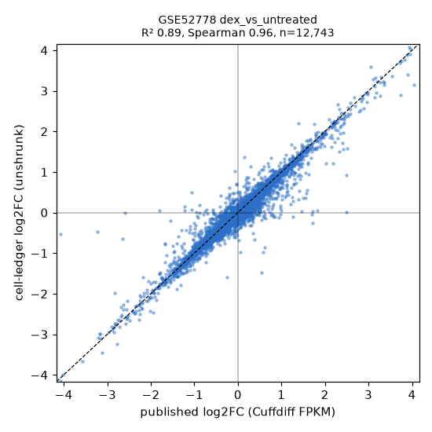
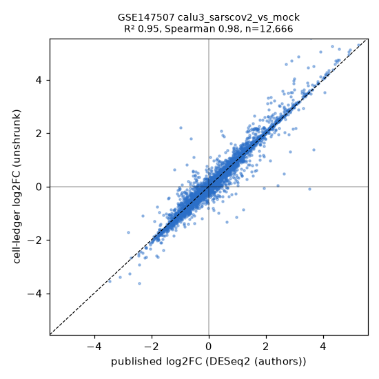
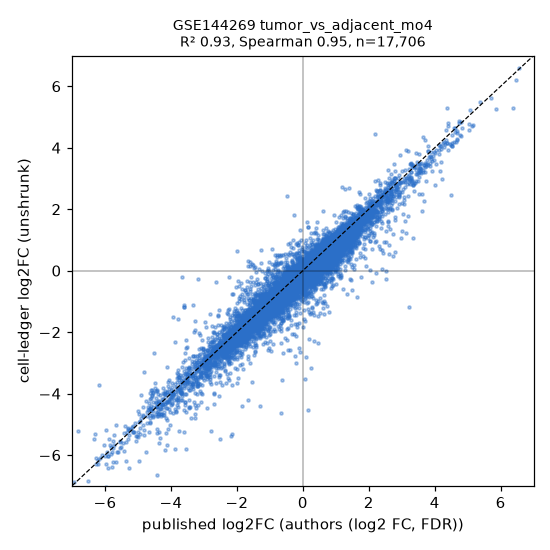

# Published differential expression as a check on the pipeline

Three GEO series whose authors published genome-wide differential expression tables were
run through the standard two-group pipeline (`cell-ledger run`, pydeseq2 0.5.4) from the
NCBI-generated raw counts, and the pipeline's `de_results.tsv` was compared gene by gene
with what the authors reported. Run on 2026-11-07 on branch `pipeline-validation`.

Everything here is regenerated by `mise run validate:published` (fetch, build designs, run the
pipeline, compare, export the page data). Scripts live in `scripts/validation/`; the downloaded
tables and run outputs stay in the gitignored `data/published/` and `data/runs/`.

## Datasets

| GEO | Paper | Comparison(s) | Authors' method | Published table used |
| --- | --- | --- | --- | --- |
| GSE52778 | Himes 2014, PLoS ONE (PMID 24926665) | dexamethasone vs untreated airway smooth muscle cells, 4 donor lines | Cuffdiff 2.0.2 on FPKM, pooled 4 vs 4 | `GSE52778_Dex_vs_Untreated_gene_exp.diff.gz` deposited on GEO |
| GSE147507 | Blanco-Melo 2020, Cell (PMID 32416070) | virus-infected vs mock cell lines: NHBE SARS-CoV-2, IAV, IAVdNS1; A549 SARS-CoV-2 (MOI 0.2 and 2), RSV, HPIV3; Calu-3 SARS-CoV-2 | DESeq2 | Cell Tables S1 and S2 (log2FC and padj only, via Europe PMC) and bioRxiv v1 Supplementary Table 2 (full DESeq2 output for the MOI 0.2 A549 experiment) |
| GSE144269 | Candia 2020, Nat Commun (PMID 32873799) | HCC tumor vs paired non-tumor liver, within each molecular subclass MO1 to MO4 (21, 17, 12, 20 pairs) | paired t-test on voom values, per subclass | Supplementary Data 5 (via Europe PMC); subclass membership from the Source Data `Fig. 1c` sheet, patient id from the RNA-seq id in each GEO sample title |

Candidate datasets were screened for three things: NCBI raw counts exist on the GEO FTP,
the paper (or GEO itself) carries a full gene-level table rather than a list of top hits, and
the comparison is a two-group contrast the pipeline can express. GSE152418 and GSE171110
(COVID-19 blood) have counts but no retrievable published table and were dropped.

## How the comparison is made

- Design files (`scripts/validation/designs/*.json`) were written from the GEO SOFT
  metadata by `build_designs.py`; every label cites the verbatim GEO string, so they pass
  the same `SampleSheet` and `Contrast` checks the app applies. The LLM discovery and
  design steps were not part of this check.
- The pipeline ran with default parameters (minimum 10 counts in the smallest arm's number
  of samples, alpha 0.05, LFC shrinkage on) and `--no-enrichment`. GSE52778 was run both
  paired by donor (`~block + arm`) and unpaired; GSE147507 is one contrast per GEO series,
  infected vs that series' own mock samples; GSE144269 is one paired contrast per subclass.
- Published genes were mapped to NCBI GeneID through the annotation table the runs use:
  Ensembl ids directly, symbols through current symbols then synonyms. Mapping counts are in
  `summary.tsv` (`mapping` column). Metrics are computed over genes tested on both sides.
- Metrics: R² (squared Pearson correlation) and Spearman correlation of log2 fold changes
  (the pipeline's unshrunk estimate against the authors' value), Spearman of Wald statistics
  where published, overlap of the significant sets at padj < 0.05 (Jaccard, recall of the
  authors' genes, precision), the share of the authors' significant genes whose direction the
  pipeline agrees with, and top-100 / top-500 overlap.
- The Cell tables fill genes not tested in a comparison with a log2FC of exactly 0 and a
  padj of exactly 0 (or 1); exact zeros are treated as untested. Cuffdiff's fold change is
  reported as sample 2 over sample 1 and was flipped to dexamethasone over untreated.

## Results

| dataset | contrast | n | R² | Spearman | shared genes | sig. pipeline | sig. published | both | recall of published | same direction (published sig.) |
| --- | --- | --- | --- | --- | --- | --- | --- | --- | --- | --- |
| GSE52778 | dex_vs_untreated (paired) | 4 vs 4 | 0.90 | 0.96 | 12743 | 3864 | 314 | 310 | 0.99 | 0.997 |
| GSE52778 | dex_vs_untreated_unpaired | 4 vs 4 | 0.90 | 0.96 | 12721 | 2809 | 312 | 294 | 0.94 | 1.000 |
| GSE147507 | nhbe_sarscov2_vs_mock | 3 vs 3 | 0.83 | 0.92 | 13578 | 471 | 551 | 400 | 0.73 | 1.000 |
| GSE147507 | nhbe_iav_vs_mock | 4 vs 4 | 0.84 | 0.95 | 12630 | 2556 | 2855 | 2317 | 0.81 | 0.998 |
| GSE147507 | nhbe_iavdns1_vs_mock | 4 vs 4 | 0.89 | 0.96 | 12820 | 1866 | 1667 | 1519 | 0.91 | 0.999 |
| GSE147507 | a549_sarscov2_moi02_vs_mock | 3 vs 3 | 0.71 | 0.91 | 13460 | 245 | 119 | 116 | 0.97 | 1.000 |
| GSE147507 | a549_sarscov2_moi2_vs_mock | 3 vs 3 | 0.89 | 0.95 | 14122 | 8635 | 8488 | 7741 | 0.91 | 0.994 |
| GSE147507 | calu3_sarscov2_vs_mock | 3 vs 3 | 0.96 | 0.98 | 12666 | 6508 | 6867 | 6290 | 0.92 | 0.996 |
| GSE147507 | a549_rsv_vs_mock | 3 vs 3 | 0.92 | 0.96 | 12812 | 2832 | 2810 | 2303 | 0.82 | 0.995 |
| GSE147507 | a549_hpiv3_vs_mock | 3 vs 3 | 0.92 | 0.96 | 12995 | 1310 | 1339 | 1012 | 0.76 | 0.998 |
| GSE144269 | tumor_vs_adjacent_mo1 | 21 vs 21 | 0.91 | 0.93 | 17369 | 10014 | 8530 | 7792 | 0.91 | 0.991 |
| GSE144269 | tumor_vs_adjacent_mo2 | 17 vs 17 | 0.91 | 0.94 | 17776 | 5084 | 1822 | 1734 | 0.95 | 0.997 |
| GSE144269 | tumor_vs_adjacent_mo3 | 12 vs 12 | 0.95 | 0.96 | 17832 | 9035 | 7186 | 6695 | 0.93 | 0.995 |
| GSE144269 | tumor_vs_adjacent_mo4 | 19 vs 19 | 0.93 | 0.95 | 17706 | 10709 | 8380 | 7962 | 0.95 | 0.993 |

The full table with every metric is `summary.tsv` / `summary.md`; one scatter plot per row
is under `figures/` (published log2FC on x, pipeline log2FC on y, with R² and Spearman in
the title).

The same comparisons are on the app's Evals page (`/evals`, section "Does the pipeline
reproduce published results?") as interactive log2FC scatter plots with R². Their data is
hard-coded: `scripts/validation/export_web_data.py` writes
`apps/web/src/lib/validation-results.ts` with R² and Spearman over all shared genes and a
deterministic sample of up to 2,500 genes per comparison (the 1,000 furthest from the
origin, then a random draw from the centre), so the page needs no API or run directory.





### Reading the numbers

**Effect sizes and direction reproduce everywhere.** Over 12,600 to 17,800 shared genes
per comparison, R² between the pipeline's and the authors' log2 fold changes is 0.71 to
0.96 and the rank correlation 0.91 to 0.98. Of the genes the authors called significant,
99.1 to 100 % move in the same direction in the pipeline (99.6 % for Calu-3 after the padj
fill values were recognised). Where the authors published Wald statistics (the bioRxiv A549
table) the statistics correlate at 0.93. The lowest R² (0.71) is the MOI 0.2 A549 infection,
where almost nothing changes and the fold changes are small on both sides.

**Differences in the significant sets track the authors' methods, not the counts.**

- GSE52778: the pipeline recovers 310 of the 314 Cuffdiff genes (99 %) but calls 3,864.
  Cuffdiff 2.0.2 on four donor lines is far less sensitive than a paired DESeq2 fit, and the
  paper itself calls the donor-to-donor variability substantial; the fold changes of the
  extra genes sit on the diagonal (figure). The paired fit adds about 1,000 genes over the
  unpaired one and lifts recall from 94 % to 99 %, the expected gain from blocking.
- GSE147507: with three replicates per arm, recall of the authors' genes is 73 to 98 %
  and precision 47 to 97 %, with the lowest values in the weakest experiments (the MOI 0.2
  A549 infection with 119 published genes; NHBE SARS-CoV-2 with 551). Seventeen of the
  7,741 genes significant on both sides for A549 MOI 2 have opposite signs (0.2 %); they are
  moderate-count genes and are most likely gene-model differences between NCBI's RefSeq
  quantification and the authors' alignment.
- GSE144269: the pipeline's paired DESeq2 calls more genes than the authors' paired t-test
  (precision 0.34 to 0.78) while recovering 91 to 95 % of theirs in the same direction. MO2,
  the subclass with the fewest published genes (1,822), is also the only run where the
  pipeline's QC raised `possible_group_swap` and `arms_not_separated_on_pc1`: the tumor
  signal is genuinely weak there, and the flag describes that rather than a label error.

## What this does and does not show

It shows that the chain fetch -> reconcile -> filter -> pydeseq2 reproduces published fold
changes, directions and, up to the authors' model choices, significant sets on cell-line and
paired tissue data, with 3 to 21 samples per arm, paired and unpaired. It does not test
discovery, Claude's sample labelling, enrichment, covariate models, or the cross-dataset
comparison layer. Samples NCBI did not quantify (the A549-ACE2 infections and the COVID-19
lung biopsies in GSE147507) could not be checked. Gene identifier mapping loses genes the
annotation table does not carry (12,461 of 34,237 Ensembl ids in GSE144269, mostly
non-coding; 942 of 23,710 symbols in GSE147507), and the published tables themselves have
quirks (fill values in the Cell tables, exact-zero FPKM in Cuffdiff) that the comparison
script documents and handles.

## Files

```
scripts/validation/fetch_published.py     downloads counts (via cell_ledger.geo.fetch) and the published tables
scripts/validation/build_designs.py       writes designs/*.json from GEO SOFT metadata
scripts/validation/designs/*.json         the sample sheets and confirmed contrasts that were run
scripts/validation/compare_published.py   joins runs to published tables; writes summary.tsv, summary.md, figures/
scripts/validation/export_web_data.py     writes apps/web/src/lib/validation-results.ts, the Evals page's hard-coded charts
docs/validation/summary.tsv               every metric per comparison, plus QC flags and mapping counts
docs/validation/figures/*.png             one scatter plot per comparison
data/published/<GSE>/                     downloaded tables (gitignored)
data/runs/<GSE>/<contrast>/               pipeline output (gitignored)
data/validation/*_merged.tsv.gz           per-gene merged tables behind each figure (gitignored)
```

`openpyxl` was added to the dev dependency group to read the authors' Excel tables.
